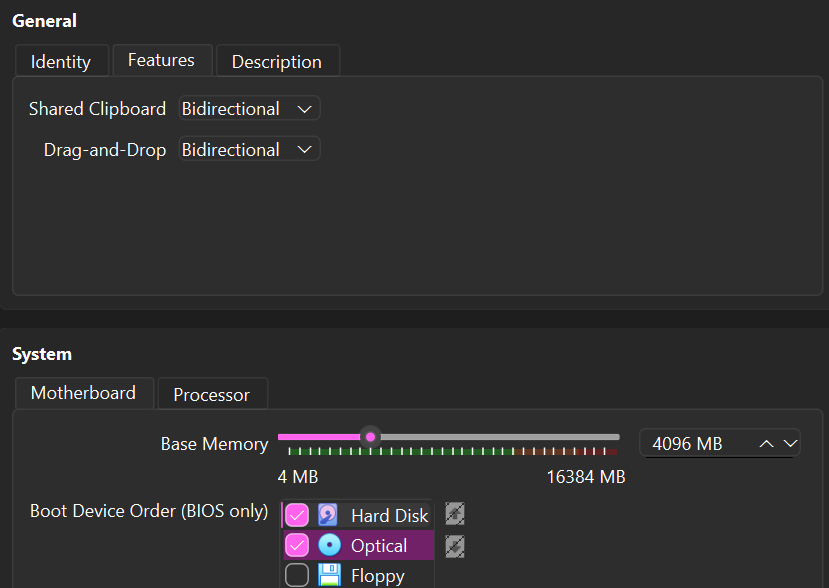
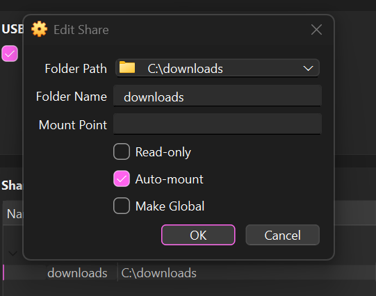
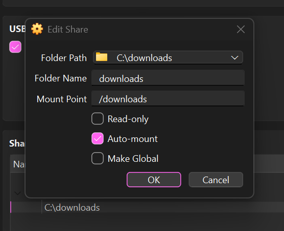
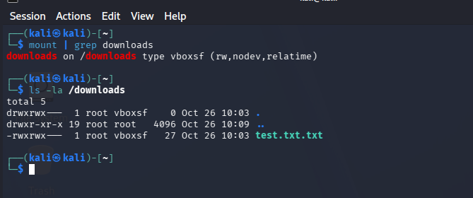
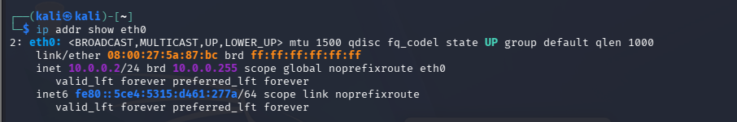
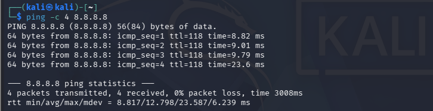
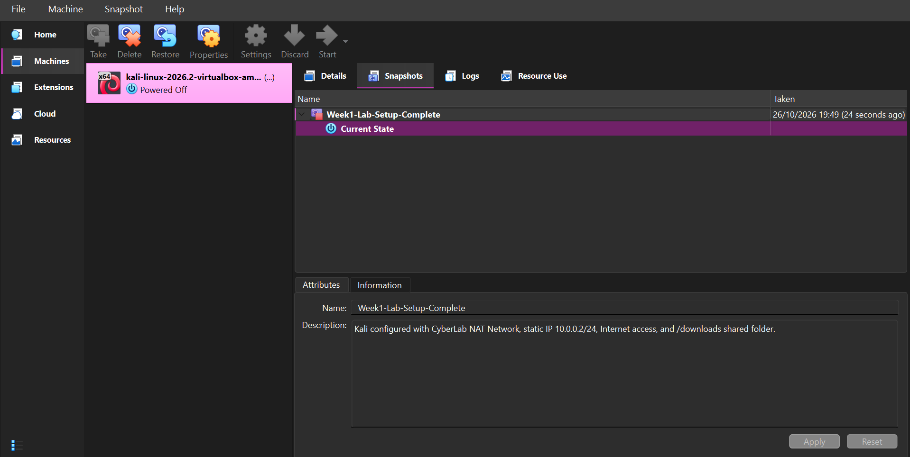

# NETWORKWALKS-B084C-WK1-PM1-CYBERSECURITY-LAB-SETUP
Week 1 Cybersecurity Lab Setup using VirtualBox and Kali Linux
# Week 1 – Cybersecurity Lab Setup

## Project Overview

This project documents the setup of a cybersecurity testing lab using **VirtualBox and Kali Linux**.

The lab was configured as an isolated environment for learning and performing authorized cybersecurity testing.

## Objectives

- Set up VirtualBox as the virtualization platform.
- Configure a custom NAT Network for the cybersecurity lab.
- Install and configure Kali Linux.
- Configure a static IP address for Kali Linux.
- Verify Internet connectivity.
- Configure VirtualBox Shared Clipboard and Drag & Drop.
- Configure a shared `/downloads` folder between Windows and Kali Linux.
- Create a clean snapshot of the completed lab environment.

## Lab Environment

| Component | Configuration |
|---|---|
| Virtualization Platform | Oracle VirtualBox |
| Attacking / Testing Machine | Kali Linux |
| NAT Network Name | CyberLab |
| Network | 10.0.0.0/24 |
| Kali IP Address | 10.0.0.2/24 |
| Gateway | 10.0.0.1 |
| DNS | 8.8.8.8 |
| Shared Folder | `/downloads` |
| Host Folder | `C:\downloads` |

## Configuration Steps

### 1. VirtualBox NAT Network

A custom NAT Network named **CyberLab** was configured using the network:

`10.0.0.0/24`

Kali Linux was connected to this NAT Network.

### 2. Kali Linux Network Configuration

Kali Linux was configured with the static IP:

`10.0.0.2/24`

The gateway was configured as:

`10.0.0.1`

Internet connectivity was verified using a ping test.

### 3. Clipboard and Drag & Drop

VirtualBox settings were configured as:

- Shared Clipboard: **Bidirectional**
- Drag & Drop: **Bidirectional**

### 4. Shared Folder

A Windows folder:

`C:\downloads`

was shared with Kali Linux and mounted at:

`/downloads`

The shared folder was tested by creating a test file on the Windows host and verifying that it was accessible from Kali Linux.

### 5. Troubleshooting

During the static IP configuration, Kali initially displayed an IP configuration error.

The issue was resolved using the NetworkManager configuration recommended in the Week 1 lab guide:

```bash
sudo nmcli connection modify "Wired connection 1" ipv4.dad-timeout 0
sudo nmcli connection down "Wired connection 1"
sudo nmcli connection up "Wired connection 1"
## Screenshots

### Clipboard and Drag & Drop



### Shared Folder



### Shared Folder Mount Point



### Shared Folder Test



### Kali Static IP



### Internet Connectivity



### Final Snapshot



## Final Result

The cybersecurity lab was successfully configured with:

- Kali Linux connected to the CyberLab NAT Network.
- Static IP `10.0.0.2/24`.
- Working Internet connectivity.
- Bidirectional clipboard and Drag & Drop.
- Functional Windows–Kali shared folder.
- A final clean snapshot for future cybersecurity lab activities.

## Conclusion

The Week 1 cybersecurity lab environment was successfully prepared using VirtualBox and Kali Linux. The environment is ready to be used for authorized cybersecurity learning and testing activities.
